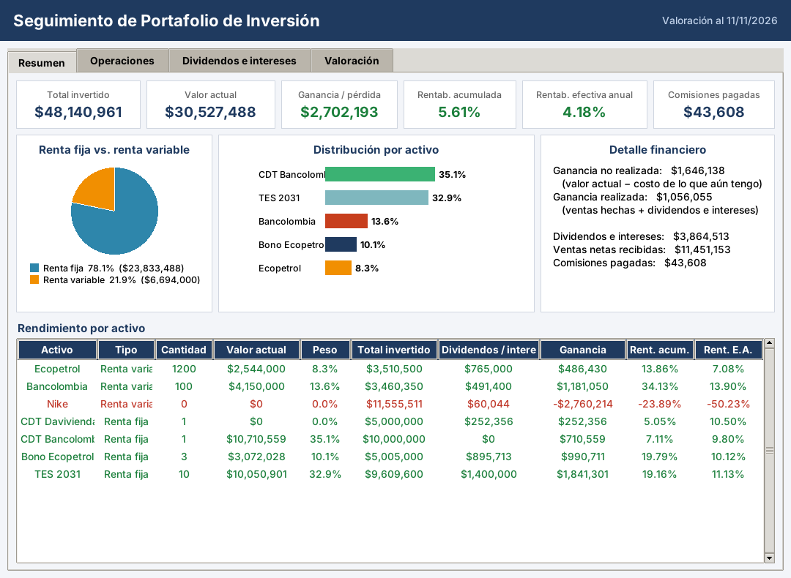
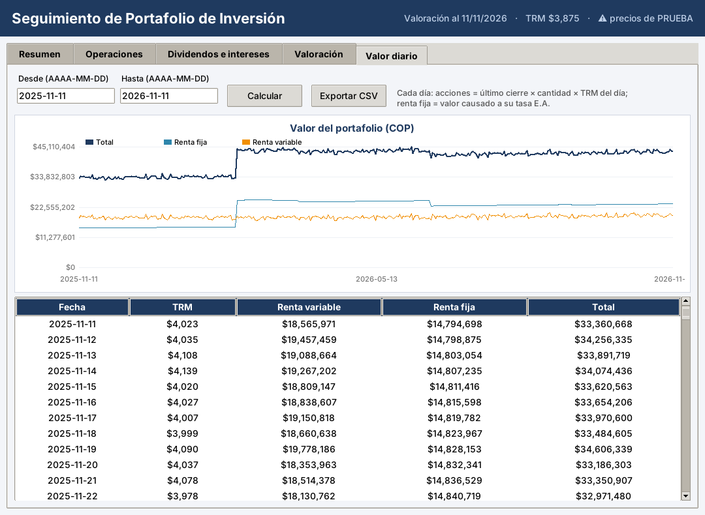
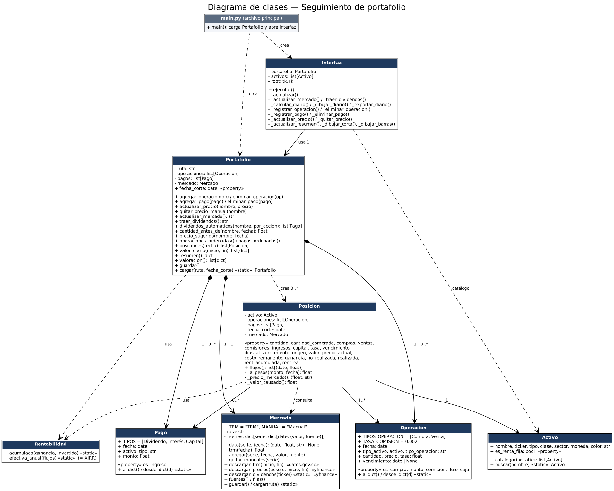

# Seguimiento de portafolio de inversión

Proyecto de la materia. Es un programa en Python con ventana (Tkinter) para llevar el control de un portafolio de inversión con acciones, CDT, bonos y TES. Con él se pueden registrar compras, ventas, dividendos e intereses, y ver cuánto se ha invertido, cuánto vale hoy el portafolio y cuál ha sido la rentabilidad.

Para comprobar que las cuentas estén bien, hicimos los mismos cálculos a mano en un Excel (`excel/Portafolio_control.xlsx`) y escribimos un script que compara los resultados del programa con los del Excel.



## Qué hace el programa

El programa tiene cinco pestañas:

- **Resumen:** total invertido, valor actual, ganancia, comisiones, rentabilidad acumulada y efectiva anual, y cuánto hay en renta fija y en renta variable.
- **Operaciones:** para registrar compras y ventas. La comisión del bróker (0,2 %) se calcula sola, y en las acciones el precio se llena con el cierre de ese día (se puede cambiar).
- **Dividendos e intereses:** para registrar dividendos, intereses y pagos de capital. Los dividendos de las acciones también se pueden traer automáticamente.
- **Valoración:** descarga los precios de las acciones y la TRM, y muestra lo que vale cada activo.
- **Valor diario:** muestra cuánto valía el portafolio cada día entre dos fechas, con un gráfico.



## Cómo correrlo

Se necesita Python 3.10 o más nuevo. En la terminal, dentro de la carpeta del proyecto:

```bash
pip install -r requirements.txt
python main.py
```

En Windows puede ser `py` en vez de `python`.

La primera vez hay que ir a **Valoración** y darle a **Actualizar precios de mercado**. El proyecto trae unos precios de prueba inventados para que funcione sin internet, y arriba sale un aviso hasta que se descargan los reales.

Las operaciones y los pagos se guardan en `datos/portafolio.json`, y los precios y la TRM en `datos/mercado.csv`.

## De dónde salen los datos

- **Precios de las acciones:** de Yahoo Finance con la librería `yfinance`. Usamos Ecopetrol, Grupo Energía Bogotá y Cibest preferencial (antes Bancolombia) de la Bolsa de Colombia, en pesos, y Nike, Nu Holdings y el ADR de Grupo Cibest de la Bolsa de Nueva York, en dólares. Tomamos el precio de cierre normal y no el ajustado, porque el ajustado ya incluye los dividendos y los contaríamos dos veces.
- **TRM:** la oficial, de datos.gov.co. Si esa página falla, se usa el dólar de Yahoo.
- **Dividendos:** también de `yfinance`. Yahoo los da por fecha ex-dividendo (no trae la fecha de pago) y sin descontar impuestos.
- **CDT, bonos y TES:** no están en Yahoo, así que se valoran con su tasa y su fecha de vencimiento.

Pensamos en sacar los datos de investing.com, pero esa página bloquea los programas que intentan leerla y sus condiciones no lo permiten, así que no la usamos.

Cuando no hay precio un día (fin de semana o festivo), se usa el último que haya. Lo mismo con la TRM.

## Cómo se calcula

Todo termina en pesos. Lo que está en dólares se pasa a pesos con la TRM del día en que pasó.

**Compras y ventas**

1. Monto = cantidad × precio
2. Comisión = 0,2 % × monto
3. Lo que sale en una compra = (monto + comisión) × TRM del día
4. Lo que entra en una venta = (monto − comisión) × TRM del día
5. Lo que entra por un pago (dividendo, interés o capital) = monto × TRM del día

**Totales**

6. Total invertido = suma de lo que salió en las compras
7. Ventas netas = suma de lo que entró en las ventas
8. Comisiones = suma de todas las comisiones
9. Dividendos e intereses = suma de esos pagos
10. Pagos de capital = suma de la plata que devuelve la renta fija (no es ganancia, es plata que vuelve)
11. Cantidad actual = cantidad comprada − cantidad vendida

**Cuánto vale cada cosa**

12. Acción = cantidad actual × último precio de cierre × TRM de hoy. Si no hay precio descargado, se usa el último precio de compra o venta.
13. CDT, bono o TES vigente = lo invertido va creciendo con la tasa del título, y lo que ya se cobró deja de crecer desde el día en que se cobró:
    `valor = Σ compras × (1 + tasa)^(días/365) − Σ cobros × (1 + tasa)^(días/365)`
14. Título vencido = 0, porque el capital y los intereses ya se registraron como pagos.
15. Valor del portafolio = suma del valor de todos los activos
16. Peso de cada activo = valor del activo / valor del portafolio

Con la fórmula 13 un CDT al 10 % E.A. sin comisión da exactamente 10 % E.A., y un bono que paga un cupón igual a su tasa vuelve a valer lo mismo que se invirtió. Por eso la escogimos.

**Ganancia y rentabilidad**

17. Ganancia total = valor actual + ventas netas + dividendos e intereses + capital − total invertido
18. Costo de lo que todavía tenemos = cantidad actual × (total invertido / cantidad comprada) − capital devuelto (0 si el título ya venció)
19. Ganancia no realizada = valor actual − costo de lo que todavía tenemos
20. Ganancia realizada = ganancia total − ganancia no realizada
21. Rentabilidad acumulada = ganancia total / total invertido
22. Rentabilidad efectiva anual = la tasa que hace que todos los flujos traídos a valor presente den cero, contando el valor actual como último flujo. Es lo mismo que la función `TIR.NO.PER` (XIRR) de Excel, con años de 365 días.
23. Días al vencimiento = fecha de vencimiento − hoy

**Dividendos automáticos**

24. Acciones con derecho al dividendo = las que se tenían antes de la fecha ex-dividendo. Si se compró ese mismo día o después, no se cobra.
25. Dividendo = acciones con derecho × dividendo por acción. Se registra con la fecha ex-dividendo.

**Valor diario**

26. El valor de cada día se calcula como si ese día fuera hoy: cantidades a ese día, último cierre, TRM de ese día y renta fija con la tasa.

## Comparar con el Excel

```bash
python pruebas/llenar_excel.py          # pasa los datos del programa al Excel
python pruebas/comparar_con_excel.py    # compara los resultados
python -m unittest discover -s pruebas -p "pruebas_*.py"
```

Entre el primero y el segundo hay que abrir el Excel, guardarlo y cerrarlo, para que recalcule. El script compara los totales, cada activo y cada día del valor diario. Con los datos de ejemplo coinciden todos los valores (permitimos una diferencia de un centavo).

## Archivos del proyecto

Cada clase está en su propio archivo:

- `main.py`: archivo principal, abre el programa.
- `Interfaz.py`: la ventana con las pestañas.
- `portafolio.py`: guarda las operaciones y los pagos, y arma el resumen.
- `posicion.py`: los cálculos de un activo (valor, ganancia, rentabilidad).
- `mercado.py`: los precios, la TRM y las descargas.
- `rentabilidad.py`: rentabilidad acumulada y efectiva anual.
- `activo.py`: la lista de activos con su ticker y moneda.
- `operacion.py`: una compra o venta.
- `pago.py`: un dividendo, interés o pago de capital.

Para agregar otra acción basta con una línea en `activo.py` y la misma fila en la hoja Activos del Excel. Las acciones de la Bolsa de Colombia en Yahoo terminan en `.CL`.



## Equipo

Ramas: `main`, `David` (interfaz), `Cris` y `Sebas` (cálculos, datos de mercado, Excel y documentación).

## Uso de inteligencia artificial

Parte del código, el Excel de control y la documentación se hicieron con ayuda de Claude (Anthropic), un asistente de IA. Nosotros revisamos el código, probamos el programa y validamos los cálculos contra el Excel.
