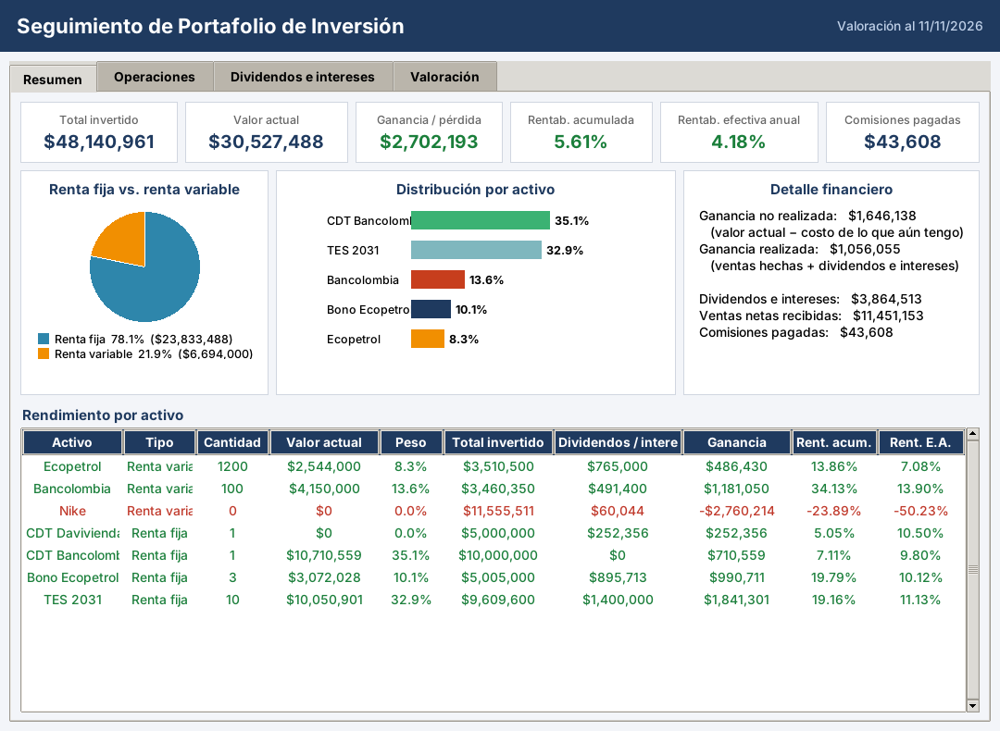
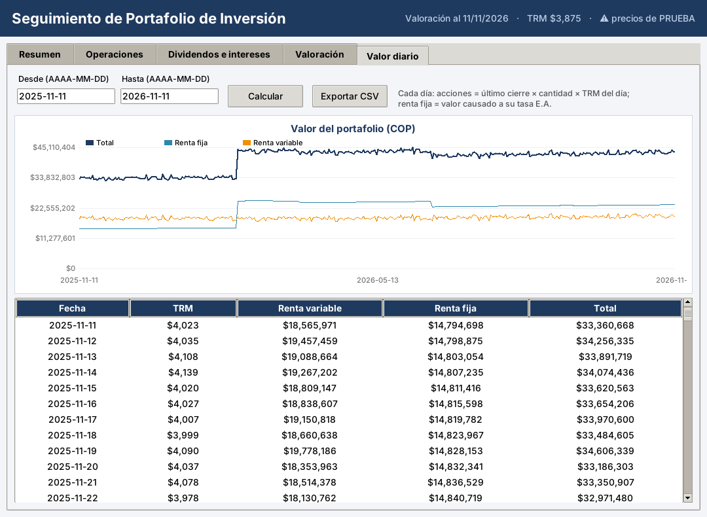
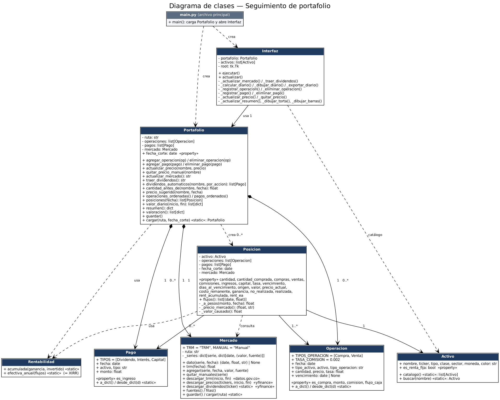

# Seguimiento de portafolio de inversión

Programa en Python con interfaz gráfica (Tkinter) para registrar y evaluar un portafolio de
**renta variable** (acciones) y **renta fija** (CDT, bonos y TES). Descarga los precios de las
acciones con **yfinance** y la **TRM oficial** de datos.gov.co, cobra la **comisión del bróker
(0,2 % por transacción)**, calcula la rentabilidad acumulada y la **efectiva anual (E.A.)**, y
valora el portafolio **día por día** en el rango de fechas que se elija.

Los resultados se comprueban contra el **Excel de control** (`excel/Portafolio_control.xlsx`),
que hace los mismos cálculos con fórmulas.



## Qué hace

| Requisito | Dónde |
|---|---|
| Registrar compras y ventas (fecha, cantidad, precio) de acciones, CDT, bonos y TES; la comisión se calcula sola y el precio de las acciones se sugiere con el cierre de ese día | Pestaña **Operaciones** |
| Registrar dividendos, intereses y pagos de capital; los dividendos de las acciones se pueden traer automáticamente de yfinance | Pestaña **Dividendos e intereses** |
| Traer precios de mercado (yfinance) y TRM; valorar renta fija por tasa, plazo y vencimiento | Pestaña **Valoración** |
| Total invertido, valor actual, ganancia, comisiones, rentabilidad acumulada y E.A., distribución | Pestaña **Resumen** |
| Valor del portafolio cada día entre dos fechas (gráfico, tabla y CSV) | Pestaña **Valor diario** |



## Cómo ejecutarlo

Requiere Python 3.10 o superior.

```bash
pip install -r requirements.txt           # yfinance (descargas) y openpyxl (comparar con el Excel)
python main.py                            # valora a la fecha de hoy
python main.py --fecha-corte 2026-11-11   # valora a una fecha fija
```

Primer uso: en **Valoración**, presionar **Actualizar precios de mercado (yfinance + TRM)**.
El repositorio trae datos de mercado de **PRUEBA (sintéticos)** solo para que el programa
funcione sin internet; el encabezado lo avisa con "⚠ precios de PRUEBA" hasta que se descargan los reales.

Los datos se guardan solos: operaciones y pagos en `datos/portafolio.json`, precios y TRM en `datos/mercado.csv`.

## Fuentes de datos

| Dato | Fuente | Detalle |
|---|---|---|
| Acciones | yfinance (Yahoo Finance) | `ECOPETROL.CL` y `GEB.CL` (Grupo Energía Bogotá), de la Bolsa de Colombia, en COP; `CIB` (Grupo Cibest), `NKE` (Nike) y `NU` (Nu Holdings), de la Bolsa de Nueva York, en USD. Precio de **cierre sin ajustar**, porque los dividendos se registran aparte (el ajustado los contaría dos veces). |
| Dividendos | yfinance (`Ticker.dividends`) | Monto bruto por acción y **fecha ex-dividendo**; Yahoo no trae la fecha de pago. Nu Holdings no paga dividendos. Para algunas acciones de la Bolsa de Colombia Yahoo puede no tener el historial: en ese caso se registran a mano. |
| TRM | datos.gov.co, conjunto `32sa-8pi3` (TRM certificada por la Superintendencia Financiera) | Si falla, respaldo con el dólar de Yahoo `COP=X`. |
| CDT, bonos, TES | Tasa E.A. y vencimiento del título | No cotizan en Yahoo Finance; se valoran con su tasa (ver fórmulas). |
| investing.com | No se usa | Está protegido contra bots (Cloudflare) y sus condiciones de uso prohíben el raspado; un scraper se rompe seguido. |

Al registrar una compra o venta de una acción, el precio se llena solo con el cierre de ese día (o el último
anterior, si fue fin de semana o aún no hay cierre). Se puede cambiar por el precio real de la operación, que
puede ser distinto del cierre. La renta fija no tiene precio de mercado en Yahoo: se escribe el valor invertido por título.

**Dividendos automáticos:** el botón **Traer dividendos (yfinance)** reemplaza los dividendos registrados de cada
acción por los de Yahoo. Cobra un dividendo quien tenía la acción **antes** de la fecha ex-dividendo: si compró ese
mismo día o después, no lo cobra; si vendió antes, tampoco. El pago se registra con la fecha ex-dividendo y el monto
bruto (sin retenciones). Si después se registra otra compra o venta, se vuelve a presionar el botón.
Si Yahoo no tiene dividendos de una acción, se dejan los que estaban registrados.

Una serie (TRM o un ticker) vale, en una fecha, **su último dato con fecha menor o igual**:
los fines de semana y festivos se usa el último cierre, y la TRM del viernes cubre el fin de semana.

## Fórmulas

Notación: *q* = cantidad, *P* = precio unitario en la moneda del activo, *c* = 0,2 % (comisión),
*TRM(d)* = TRM del día *d* (vale 1 para activos en COP), *t* = tasa E.A. del título,
*V* = fecha de vencimiento, *F* = fecha de corte. Todo resultado queda en pesos (COP).

### Operaciones y pagos

| # | Concepto | Fórmula |
|---|---|---|
| 1 | Monto de una operación | `q × P` |
| 2 | Comisión del bróker | `c × q × P` (c = 0,2 % en compras y en ventas) |
| 3 | Flujo de una compra (COP) | `−(q × P + comisión) × TRM(fecha)` |
| 4 | Flujo de una venta (COP) | `+(q × P − comisión) × TRM(fecha)` |
| 5 | Flujo de un pago (COP) | `+monto × TRM(fecha del pago)` |
| 6 | TRM del día *d* | último valor de la serie TRM con fecha ≤ *d* |

### Totales

| # | Concepto | Fórmula |
|---|---|---|
| 7 | Total invertido | `Σ (q × P + comisión) × TRM(fecha)` de las compras |
| 8 | Ventas netas | `Σ (q × P − comisión) × TRM(fecha)` de las ventas |
| 9 | Comisiones pagadas | `Σ comisión × TRM(fecha)` |
| 10 | Dividendos e intereses | `Σ monto × TRM(fecha)` de pagos tipo Dividendo e Interés |
| 11 | Pagos de capital | `Σ monto` de pagos tipo Capital (dinero que vuelve, no ganancia) |
| 12 | Cantidad actual | `Σ q compras − Σ q ventas` (con fecha ≤ *F*) |

### Valoración a la fecha *F*

| # | Concepto | Fórmula |
|---|---|---|
| 13 | Valor de una acción | `q actual × último cierre (≤ F) × TRM(F)`; sin cierre: último precio de operación |
| 14 | Valor de renta fija vigente | `Σ compras_i · (1+t)^((min(F,V) − d_i)/365) − Σ cobros_j · (1+t)^((min(F,V) − d_j)/365)` |
| 15 | Valor de renta fija vencida (*F* ≥ *V*) | `0` (el capital y los intereses se registran como pagos) |
| 16 | Valor actual del portafolio | `Σ valor de cada activo` |
| 17 | Participación renta fija / variable | `valor del grupo / valor actual` |

En la fórmula 14, *compras* = q × P en COP (sin comisión), *cobros* = ventas, intereses y capital,
y *d* = fecha de cada movimiento. Cada peso invertido crece a la tasa del título y cada peso
cobrado deja de crecer el día en que se cobra. Con esta regla, un CDT al 10 % E.A. sin comisión rinde
exactamente 10 % E.A., y un bono cuyo cupón es igual a la tasa vuelve a valer lo invertido después de
pagarlo. La tasa y el vencimiento se toman de la primera compra del título.

### Resultados

| # | Concepto | Fórmula |
|---|---|---|
| 18 | Ganancia total | `valor actual + ventas netas + dividendos e intereses + capital − total invertido` |
| 19 | Costo de lo que aún se tiene | `q actual × (total invertido / q comprada) − capital` (0 si el título venció) |
| 20 | Ganancia no realizada | `valor actual − costo de lo que aún se tiene` |
| 21 | Ganancia realizada | `ganancia total − ganancia no realizada` |
| 22 | Rentabilidad acumulada | `ganancia total / total invertido` |
| 23 | Rentabilidad E.A. | la tasa *r* que cumple `Σ flujo_k / (1+r)^((d_k − d_0)/365) = 0` con los flujos 3, 4 y 5 más el valor actual en *F* (= `TIR.NO.PER` / `XIRR` de Excel) |
| 24 | Peso de un activo | `valor del activo / valor actual del portafolio` |
| 25 | Días al vencimiento | `max(0, V − F)` |

### Dividendos automáticos (yfinance)

| # | Concepto | Fórmula |
|---|---|---|
| 28 | Acciones con derecho al dividendo | `Σ q compras − Σ q ventas` con fecha **anterior** a la fecha ex-dividendo |
| 29 | Dividendo automático (moneda del activo) | `acciones con derecho × dividendo por acción`; fecha del pago = fecha ex-dividendo; luego se pasa a COP con la fórmula 5 |

### Valor diario

| # | Concepto | Fórmula |
|---|---|---|
| 26 | Valor del portafolio el día *d* | fórmulas 13 a 16 con *F* = *d*: cantidades a ese día, último cierre ≤ *d*, `TRM(d)` y renta fija causada hasta *d* |
| 27 | Rango | cada día calendario desde la fecha inicial hasta la final, sin pasar de la fecha de corte |

Lo registrado con fecha posterior a la fecha de corte no se tiene en cuenta en ningún cálculo.

### Agregar otra acción
Una línea en `Activo.catalogo()` (archivo `activo.py`) con el nombre, el ticker de Yahoo (las de la Bolsa de Colombia
terminan en `.CL`), el tipo, la clase, el sector, la moneda y un color; y la misma fila en la hoja **Activos** del Excel.
El Excel tiene espacio para 10 activos.

## Comprobar contra el Excel

```bash
python pruebas/llenar_excel.py        # copia operaciones, pagos y mercado del programa al Excel
# abrir excel/Portafolio_control.xlsx en Excel y guardarlo (recalcula todo)
python pruebas/comparar_con_excel.py  # compara cada indicador, cada activo y cada día
python -m unittest discover -s pruebas -p "pruebas_*.py"   # casos verificables a mano
```

Con los datos de ejemplo coinciden **4.828 de 4.828 valores** (totales, cada activo y 366 días del
valor diario), con un margen de 1 centavo en pesos y de 0,0001 puntos en tasas. También se probaron fechas de corte de
2023, 2025, 2027 y 2031, rangos de 2 años, precios manuales y títulos vencidos.

## Estructura (una clase por archivo)

| Archivo | Clase | Responsabilidad |
|---|---|---|
| `main.py` | — | Archivo principal: carga los datos y abre la interfaz |
| `Interfaz.py` | `Interfaz` | Ventana con las 5 pestañas |
| `portafolio.py` | `Portafolio` | Guarda operaciones y pagos, valida, arma el resumen y el valor diario |
| `posicion.py` | `Posicion` | Resultados de un activo en una fecha (fórmulas 7 a 25) |
| `mercado.py` | `Mercado` | Precios, TRM y dividendos: consulta, descarga (yfinance, datos.gov.co) y CSV |
| `rentabilidad.py` | `Rentabilidad` | Rentabilidad acumulada y E.A. (TIR) |
| `activo.py` | `Activo` | Catálogo de instrumentos (5 acciones, 2 CDT, 1 bono, 1 TES), con ticker y moneda |
| `operacion.py` | `Operacion` | Una compra o venta, con su comisión |
| `pago.py` | `Pago` | Un dividendo, interés o pago de capital |



## Equipo

Proyecto de clase. Ramas: `main`, `David` (interfaz), `Cris`, `Sebas` (modelo de cálculo, mercado, Excel de control y documentación).
