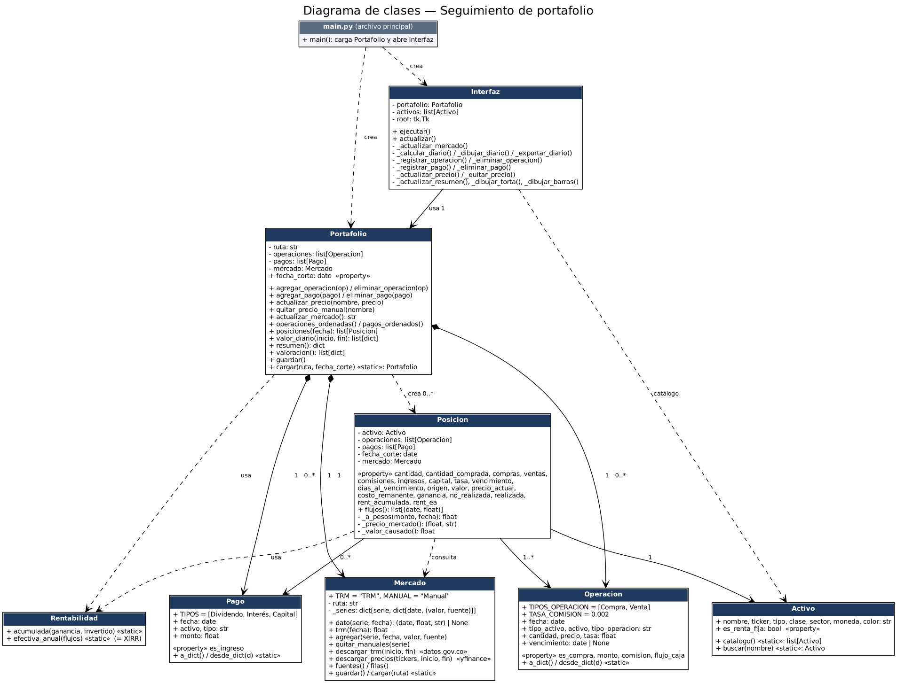

# Diagrama de clases

- `main.py` crea el `Portafolio` (cargado desde `datos/portafolio.json`) y la `Interfaz`.
- `Portafolio` contiene las `Operacion` y los `Pago` (composición) y crea una `Posicion` por activo para calcular.
- `Portafolio` contiene un `Mercado` (precios de yfinance y TRM de datos.gov.co).
- `Posicion` usa `Activo` (condiciones del instrumento), consulta el `Mercado` (cierres y TRM) y usa `Rentabilidad` (TIR).
- Fuente del diagrama: `docs/uml_clases.dot` (Graphviz: `dot -Tpng docs/uml_clases.dot -o docs/img/uml_clases.png`).
