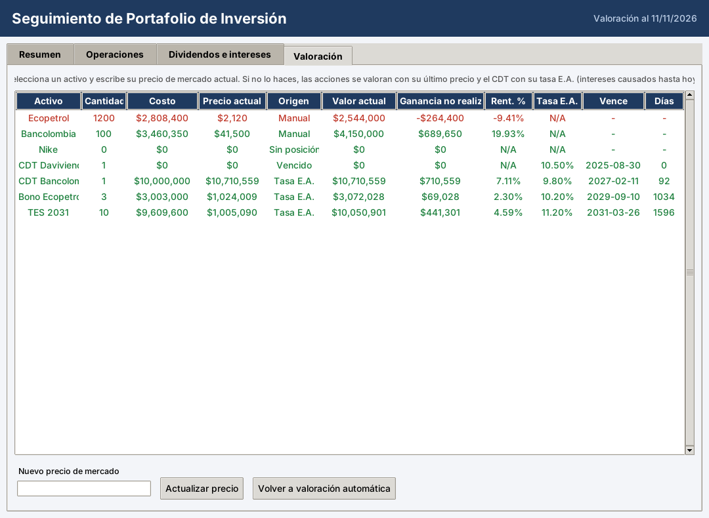

# Seguimiento de portafolio de inversión — Wiki

Sistema para monitorear y evaluar un portafolio con renta fija (CDT, bonos, TES) y renta variable (acciones).

## Páginas
- [[Instalación y uso|Instalacion-y-uso]]
- [[Cálculos financieros|Calculos-financieros]]
- [[Excel de control|Excel-de-control]]
- [[Diagrama de clases|Diagrama-de-clases]]
